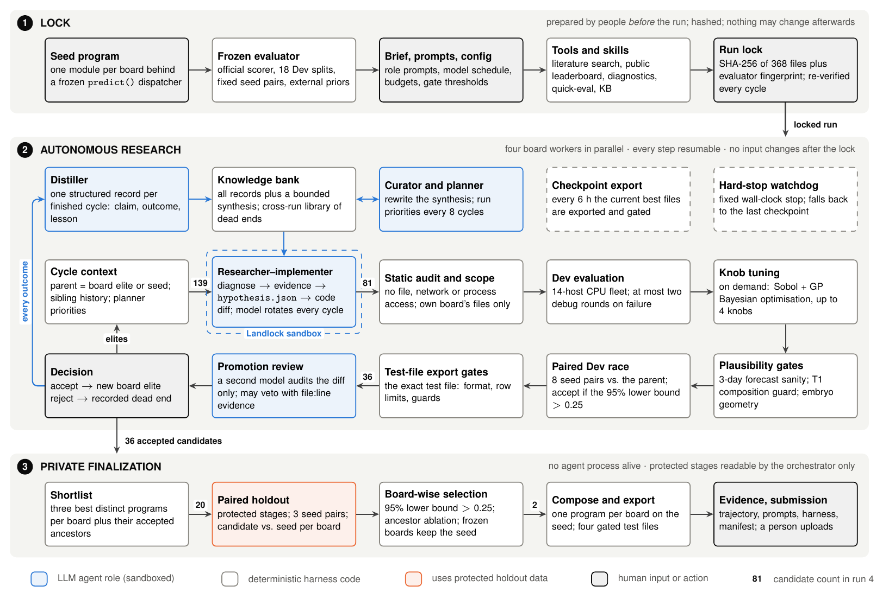
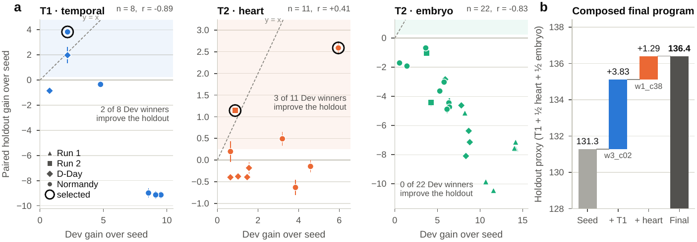
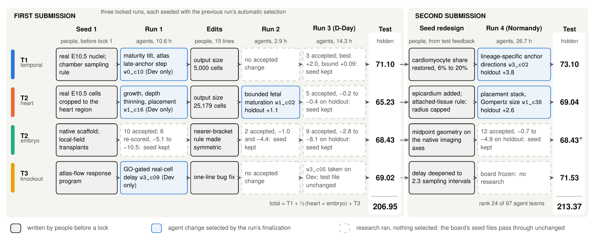
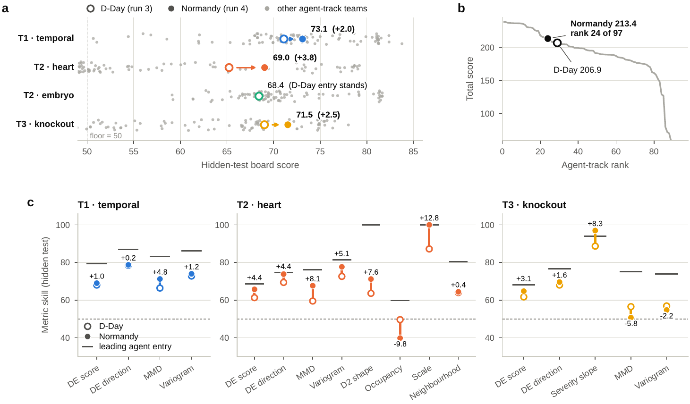
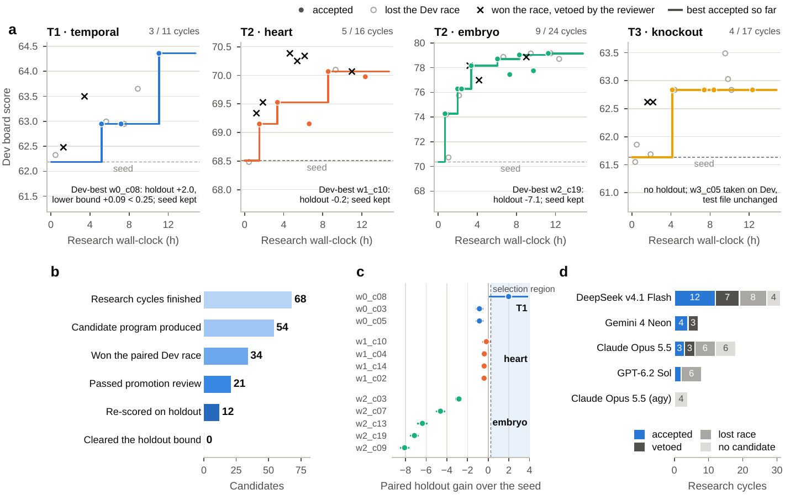
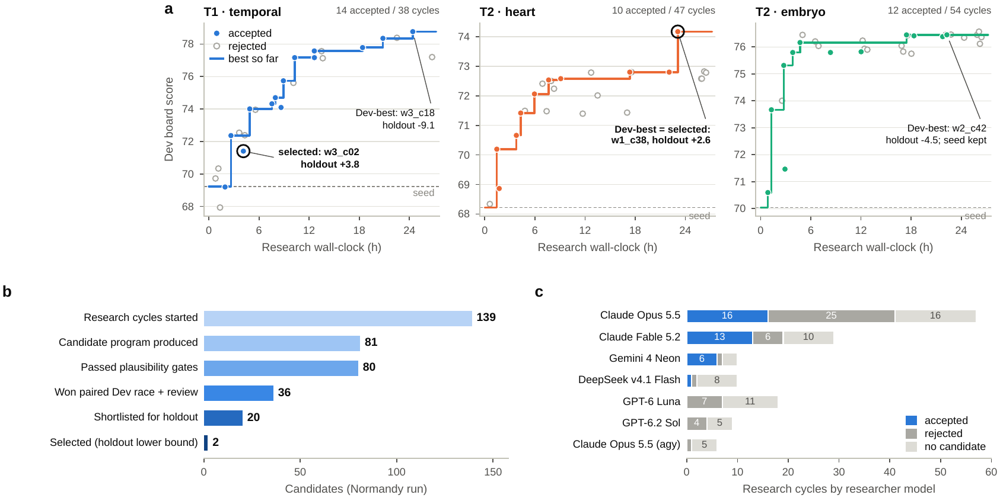

# AgenticScientist

**A locked, multi-model research-agent harness that decides which of its own results to believe.**

Entry to the Agent track of the [Virtual Embryo Challenge](https://virtualembryo.ai/challenge) (NeurIPS 2026), in which
a model must forecast single-cell expression and 3D tissue geometry of the mouse embryo across time, space and a
genetic knockout.

[**Method report (PDF, 6 pages)**](report/AgenticScientist_method_report.pdf) · [LaTeX source](report/) · [harness](agentic_scientist/) · [prompts](agentic_scientist/prompts/) · [knowledge bank](agentic_scientist/library/)



## The problem

Language-model agents can now run the whole inner loop of empirical research: read a brief, inspect data, propose a
mechanism, implement it and read a score. An agent that scores itself a hundred times a day on a fixed development set
will find changes that raise the development score for reasons that do not hold on new data. In this challenge the
decisive targets lie two to three days of embryonic development beyond the last released stage, and the Agent track
forbids a person from steering the agent once a run has started. Whatever protects a run against self-deception has
to be built into the harness before it is locked.

## Results

| | |
|---|---|
| Hidden-test total | **213.37** of 300 (floor model 150) |
| Agent-track rank | **24 of 97** teams when submissions closed (9 of 81 when the files were scored) |
| Development winners re-scored on protected stages | **41**, of which **5** improved them |
| Development gain vs. holdout gain | *r* = **−0.89** (T1) and **−0.83** (embryo); +0.41 on heart |
| Final run, development-greedy composition | +15.7 development points, **−10.1** holdout points |
| Final run, selected composition | **+5.1** on both |

The main finding is the third row. Most changes that agents won on the development splits, with tight confidence
intervals and plausible biological arguments, lost on stages the agents could not see.



*Each point is a program that an agent got accepted on the development splits and that was re-scored after research
had ended. Shaded bands mark the region in which a change is promoted; rings mark the promoted programs.*

## How it works

**1. Lock.** People prepare the seed program, the frozen evaluator, prompts, tools and configuration. All 368 files
are hashed (SHA-256) into a lock that the orchestrator re-verifies at every cycle and at finalization. No input of a
run changes after the lock.

**2. Research cycle.** Board workers run cycles in parallel. In each cycle a single model session, sandboxed
with Linux Landlock, collects evidence, diagnoses one metric gap, writes a falsifiable `hypothesis.json` and
implements the change. The researcher model rotates every cycle across vendors (Claude Fable 5.2, GPT-6.2 Sol, Gemini 4
Neon). When a provider's quota runs out the orchestrator detects it and reroutes the role along a fixed fallback
chain.

**3. Paired racing.** A candidate and its parent are evaluated on the same (prediction seed, fit seed) pairs. The
candidate is accepted only if the one-sided 95% lower bound of the paired gain exceeds a margin, and no group of
splits that shares a stage, protocol or knockout gene loses. Numeric constants are tuned by the harness with Bayesian
optimisation, never by an agent.

**4. Gates and review.** Plausibility gates run without ground truth. A second model then audits the diff against
the hypothesis and may veto with file and line evidence.

**5. Holdout-calibrated selection.** After every agent has exited, shortlisted programs are re-scored on protected
stages that no agent could read. A board's change is promoted only if its paired lower bound beats the seed;
otherwise the board keeps the seed. Boards whose local splits cannot order programs of known test score are frozen
and excluded from research.

**6. Knowledge bank.** Every finished cycle is distilled into a structured record (claim, mechanism, outcome with
statistics, retry condition). Records persist across runs, so a later run starts knowing which ideas failed and why.

## What was submitted



*Each row follows one board's program through the four locked runs. Grey cells were written by people before a lock,
blue cells are agent changes that a run's finalization selected, dashed cells are runs in which nothing was selected.*

The forecasting method is one program with one interface, `predict(board, inputs, times, target_time, context)`. It
trains no neural network: each board is a non-parametric sampler, fitted at prediction time, that emits measured cells
and decides which ones.

| Board | Target | Program | Hidden-test score |
|---|---|---|---|
| T1 temporal | E12.5 heart chambers | 5,000 real E10.5 nuclei, chamber conditioning, maturity tilt, expression continued along lineage-specific atlas directions (agent change) | 73.10 |
| T2 heart | E12.5 dissected heart | 25,179 real organ-resident E10.5 cells with epicardium, placement stack and growth law (four stacked agent changes) | 69.04 |
| T2 embryo | E7.75 whole embryo | cells and positions of the nearer bracketing embryo, expression transplanted from the other bracket (seed) | 68.43 |
| T3 knockout | E8.75 β-catenin mutant | developmental delay made only of measured wild-type cells, gated by gene ontology (seed, board frozen) | 71.53 |



*Board scores of the two submitted runs against the other Agent-track teams, total score by rank, and metric skills
on the three boards that changed between the two submissions.*

## Two runs in detail

**A run that returned its seed.** The third locked run finished 68 cycles and accepted 21 changes. Twelve were
re-scored on protected stages and none cleared the bound, so the run exported the files it had started from. Taking
each board's development-best program instead would have gained 8.6 development points and lost 1.7 on the holdout.



**The final run.** In 26.7 hours the fourth run started 139 cycles and accepted 36 changes. On T1 the
development-best program had gained 9.5 development points through four stacked edits and lost 9.1 on the two-day
holdout; its early ancestor, with a development gain of 2.2, gained 3.8 and was selected.



## What is owed to agents and what to people

The lock moves human influence; it does not remove it. The largest single-board gains between the two submissions
followed changes that people made to the seed after reading the per-metric test feedback of the first submission. The
agents ran everything after the lock and found the selected T1 and heart changes. The embryo and T3 files are the
output of human-prepared seed code executed by the harness. The [report](report/AgenticScientist_method_report.pdf)
gives the full account, including limitations.

## Repository layout

| Path | Contents |
|---|---|
| [`agentic_scientist/orchestrator.py`](agentic_scientist/orchestrator.py) | The orchestrator: research cycles, model routing, paired race, review, finalization |
| [`agentic_scientist/evaluate.py`](agentic_scientist/evaluate.py), [`tune.py`](agentic_scientist/tune.py), [`sanity.py`](agentic_scientist/sanity.py), [`composition.py`](agentic_scientist/composition.py), [`native.py`](agentic_scientist/native.py) | Frozen evaluator, harness-side tuning and the gates |
| [`agentic_scientist/landlock.py`](agentic_scientist/landlock.py), [`sandbox.py`](agentic_scientist/sandbox.py) | Unprivileged filesystem sandbox for agents and for program execution |
| [`agentic_scientist/make_lock.py`](agentic_scientist/make_lock.py), [`export_final.py`](agentic_scientist/export_final.py) | Run lock; export, gating and evidence packaging |
| [`agentic_scientist/prompts/`](agentic_scientist/prompts/) | Research briefs and role prompts of every run |
| [`agentic_scientist/seed_normandy/`](agentic_scientist/seed_normandy/), `seed_*/` | Seed programs of the locked runs (one module group per board) |
| [`agentic_scientist/skills/`](agentic_scientist/skills/), [`tools/`](agentic_scientist/tools/) | Skills and tools available to agents: diagnostics, literature search, leaderboard reader, quick evaluation |
| [`agentic_scientist/library/`](agentic_scientist/library/) | Cross-run knowledge bank: 90 distilled records, lessons and the holdout ledger |
| [`shinka_ve/`](shinka_ve/) | Evaluation core, grown out of a [ShinkaEvolve](https://arxiv.org/abs/2509.19349) program-evolution pipeline |
| [`report/`](report/) | Method report: PDF, LaTeX source, TikZ diagrams, figure code and the data behind every plot |
| [`docs/external_provenance.json`](docs/external_provenance.json) | Every external source with its stage filter and build script |
| `focused/`, `humantrack/`, `models/`, `results/`, `experiments/`, `src/`, `scripts/` | Earlier board-focused lanes, pilots and support scripts, kept for provenance |

## Running it

The repository contains code, prompts and records, not data. A run needs:

1. Linux with Landlock, Python 3.12 and the pinned [`requirements.txt`](requirements.txt).
2. The challenge stages from the official downloads, and the external priors rebuilt with the scripts named in
   [`docs/external_provenance.json`](docs/external_provenance.json).
3. The vendor command-line agents (Claude Code, Codex CLI, Antigravity CLI, OpenCode, CommandCode) with their own
   subscriptions.

```sh
python agentic_scientist/make_lock.py "note for this lock"        # hash every input of the run
agentic_scientist/supervise_final.sh <lock.json> <run-name> agentic_scientist/config_normandy.json
python agentic_scientist/export_final.py --workspace <selected workspace> --out <dir>
```

The last command is deterministic and needs no language model: it runs a selected program on the test inputs, applies
the official format check and writes the four `.h5ad` files with their SHA-256. A repeated research run will not
reproduce the same candidates, because the language models are not deterministic and provider quotas change which
model serves a cycle.

Figures of the report are rebuilt with `python report/figs.py` from `report/data/*.json`.

## What is not in this repository

- Challenge data and anything derived from it (stages, gene panels, reference arrays), and the submitted prediction
  files. The dataset is unpublished and may not be redistributed.
- Run directories with agent transcripts; `report/data/runs.json` holds the per-cycle records behind the figures.
- Raw public leaderboard snapshots. The copy used for the hidden-test figure has all other teams' names removed.
- Third-party papers and vendored code.

File paths and host names of the compute cluster are replaced by placeholders.

## Acknowledgements

We thank the organisers of the Virtual Embryo Challenge for the benchmark, the scoring code and the public
leaderboard, and Dr. Qingquan Zhang and Dr. Neil Chi (University of California, San Diego) and their team for
generating the challenge data. External sources and their filters are listed in the report and in
[`docs/external_provenance.json`](docs/external_provenance.json).
